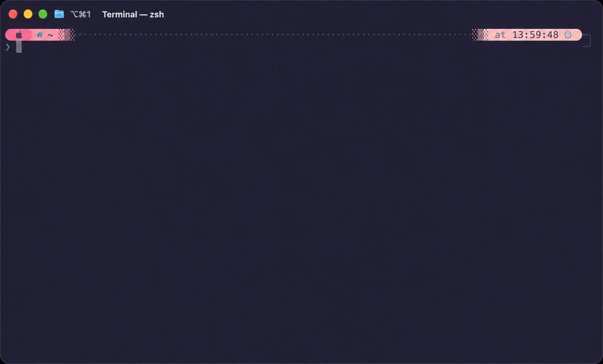
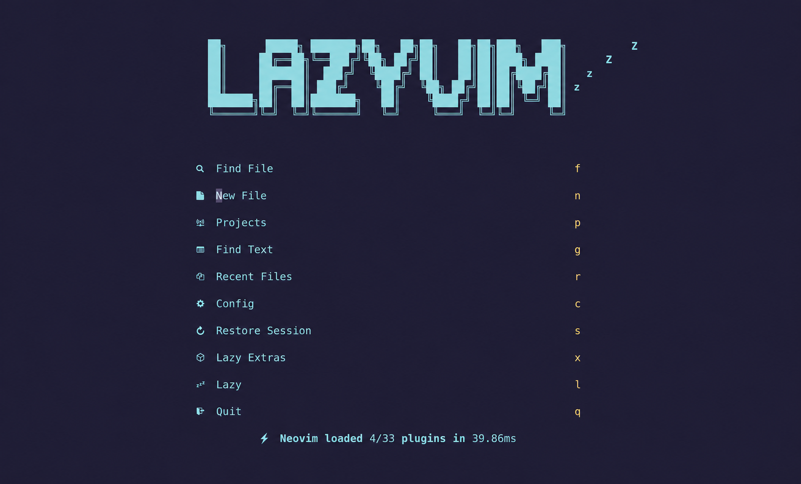
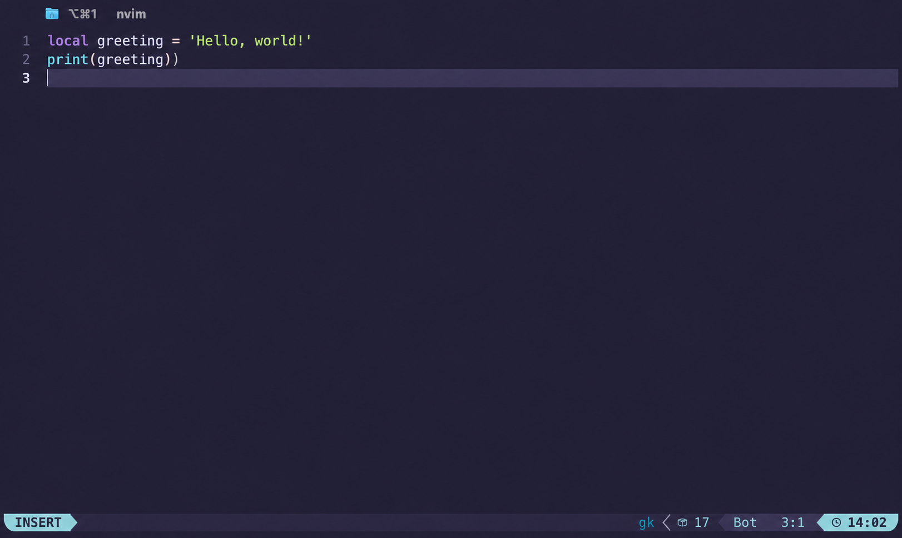
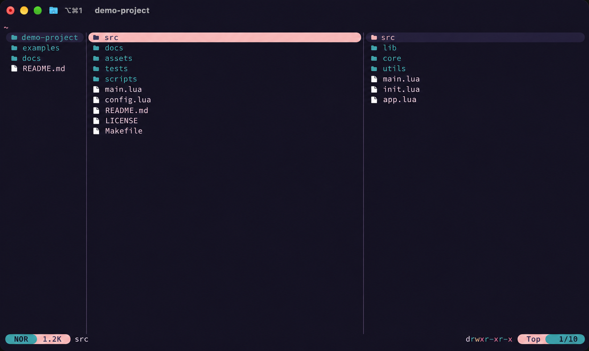
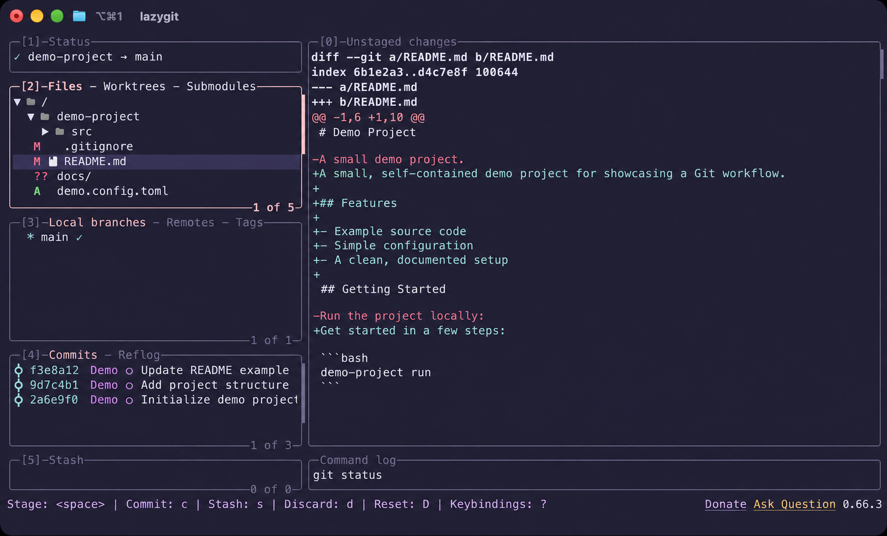

# Mes Dotfiles

[Langues / Languages](README.md) · Français · [English](README.en.md)

Configuration de développement pour macOS Apple Silicon. Le dépôt rassemble
les fichiers de configuration et un installateur qui vérifie les conflits
avant de créer les liens symboliques.

## Captures d’écran

Captures retouchées avec des exemples fictifs.











## Installation

### Prérequis

La configuration actuelle cible les Mac Apple Silicon avec Homebrew installé
dans `/opt/homebrew`.

- Installez Git et Homebrew, puis vérifiez que les commandes `git` et `brew`
  sont disponibles dans votre terminal.
- Installez Oh My Zsh dans `~/.oh-my-zsh`, où le fichier `.zshrc` le charge.
- Installez Visual Studio Code dans `/Applications` et rendez la commande `code`
  disponible avant de lancer le script. Le `Brewfile` contient l’extension Rosé
  Pine. Si `code` est introuvable, ouvrez la palette de commandes de VS Code et
  exécutez **Shell Command: Install 'code' command in PATH**, puis ouvrez un
  nouveau terminal.

### Installer les dotfiles

Clonez le dépôt dans `~/dotfiles`. Les alias Zsh `dotfiles`, `dot` et
`brewfile` utilisent ce chemin. Si vous choisissez un autre emplacement, adaptez
les chemins dans [`zsh/.zsh_aliases`](zsh/.zsh_aliases).

```bash
git clone https://github.com/pjchariol/macos-dotfiles-public.git ~/dotfiles
cd ~/dotfiles
```

Rendre le script exécutable puis lancer l'installation :

```bash
chmod +x install.sh
./install.sh
```

Le script installe les dépendances déclarées dans le `Brewfile` et crée les
liens symboliques nécessaires pour Git, Zsh, Yazi, Lazygit et Neovim.

Si le script détecte des configurations existantes en conflit, il affiche les
chemins concernés et s’arrête avant l’installation. Déplacez ces fichiers vers
un dossier de sauvegarde, puis relancez le script.

Après l’installation, ouvrez un nouveau terminal ou exécutez `source ~/.zshrc`.

### Configuration de Git

Les informations personnelles Git ne sont pas incluses dans ce dépôt.

Si `~/.gitconfig.local` n'existe pas, le script d'installation propose de
configurer automatiquement votre identité Git.

Si vous choisissez de ne pas le faire immédiatement, un fichier
`~/.gitconfig.local` est créé à partir du modèle fourni. Il suffit alors de
renseigner vos informations :

```ini
[user]
    name = Votre Nom
    email = votre@email.com
```

Le fichier `~/.gitconfig.local` se trouve dans votre dossier personnel.
Le dépôt contient un modèle `git/.gitconfig.local.example`.

---

## Dépendances

Le [Brewfile](Brewfile) installe les outils suivants lors de l’installation
standard. Git, Homebrew, Oh My Zsh et VS Code sont à installer au préalable.

- Terminal et navigation · Powerlevel10k, Zsh Autocomplete, Zsh Autosuggestions,
  Zsh Syntax Highlighting, FZF, Zoxide, Bat et Eza.
- Édition et recherche · Neovim, Lazygit, Yazi, fd, ripgrep, jq et l’extension
  Rosé Pine pour VS Code.
- Exécution et aperçu · Node.js, Python 3.11, FFmpeg, ImageMagick, Poppler
  et 7-Zip.

### Outils facultatifs

- iTerm2 sert à utiliser le préréglage de couleurs fourni.
- NVM peut gérer plusieurs versions de Node.js. Zsh le charge depuis Homebrew
  ou depuis `NVM_DIR` (par défaut `~/.nvm`) s’il est présent.
- OpenJDK 25 est utilisé s’il est installé via Homebrew. L’alias `rars`
  nécessite une commande `java` et le fichier `~/rars-1.7.jar`, à fournir
  séparément.
- OPAM est chargé uniquement si son script d’initialisation existe.

## Outils utilisés

### Homebrew

Le `Brewfile` versionné liste les dépendances de la configuration publique. Pour
exporter l’inventaire des logiciels de votre Mac, lancez `bash ./brew.sh` depuis
le dépôt. Le script écrit dans `Brewfile.local`, ignoré par Git.

---

### Git

Configuration Git personnalisée avec :

- aliases utiles
- rebase par défaut
- `rerere`
- `zdiff3`
- configuration reproductible

---

### Zsh

Configuration entièrement documentée et séparée en plusieurs fichiers :

- `.zsh_aliases`
- `.zsh_functions`
- `.zsh_plugins`
- `.zshrc`

---

### Powerlevel10k

Thème du terminal affichant notamment :

- la branche Git
- le dossier courant
- l'état du dépôt
- la durée des commandes
- les indicateurs utiles

---

### iTerm2

Terminal principal utilisant le thème **Rosé Pine Moon**.

Installez iTerm2 séparément. Dans les réglages d’iTerm2, ouvrez
**Profiles → Colors → Color Presets**, choisissez **Import**, puis
sélectionnez
[iterm2/rose-pine-moon.itermcolors](iterm2/rose-pine-moon.itermcolors).
Sélectionnez ensuite **Rosé Pine Moon** dans les préréglages du profil.

---

### Zoxide

Navigation intelligente entre les dossiers.

Après avoir visité un dossier, par exemple `~/Projets/exemple`, vous pouvez y
revenir en tapant une partie de son nom.

```bash
z exemple
```

---

### FZF

Recherche interactive dans le terminal.

Principales fonctionnalités :

- historique (`Ctrl + R`)
- recherche de fichiers (`Ctrl + T`)
- recherche de dossiers (`Option + C`)

---

### Yazi

Gestionnaire de fichiers moderne dans le terminal.

Permet notamment :

- naviguer rapidement
- ouvrir VS Code
- prévisualiser des fichiers
- éviter Finder

Personnalisé avec le thème **Rosé Pine**.

---

### Lazygit

Interface Git dans le terminal.

Permet de gérer Git efficacement sans mémoriser toutes les commandes.

Personnalisé avec le thème **Rosé Pine**.

---

### VS Code

Éditeur principal.

Le `Brewfile` installe l’extension Rosé Pine. Pour activer **Rosé Pine Moon**,
sélectionnez-le dans la commande **Preferences: Color Theme** de VS Code.

---

### Neovim

Éditeur de texte moderne utilisé pour les modifications rapides et le
développement directement dans le terminal.

Configuration basée sur **LazyVim**, avec notamment :

- gestionnaire de plugins `lazy.nvim`
- thème **Rosé Pine Moon**
- Treesitter
- LSP
- autocomplétion
- formatage automatique

---

### Bat

Remplacement moderne de `cat`.

Ajoute :

- coloration syntaxique
- numéros de ligne
- meilleur affichage

---

### Eza

Remplacement moderne de `ls`.

Utilisé pour l'affichage des fichiers et de l'arborescence.

---

## Personnalisation et désinstallation

Modifiez les fichiers de configuration dans le dépôt pour mettre à jour les
fichiers liés. Gardez votre identité Git dans `~/.gitconfig.local`.
L’inventaire `Brewfile.local` reste hors de Git.

Pour désinstaller, vérifiez où pointent les liens avec `ls -l`. Retirez
uniquement les liens vers ce dépôt et restaurez vos sauvegardes. Les liens
concernés sont les cinq fichiers Zsh du dépôt à la racine du dossier personnel,
`~/.gitconfig`, `~/.config/nvim`, les trois fichiers TOML de
`~/.config/yazi` et `config.yml` dans
`~/Library/Application Support/lazygit`. Conservez `~/.gitconfig.local` si vous
souhaitez réutiliser votre identité. Les paquets Homebrew se gèrent séparément.
Si le script a créé le lien Homebrew vers `code`, vous pouvez le retirer après
avoir vérifié sa cible.

## Contrôles automatisés

[GitHub Actions](.github/workflows/shell-checks.yml) lance ShellCheck et
`bash -n` sur les scripts Bash, puis `zsh -n` sur les cinq fichiers Zsh,
à chaque push et pull request. Ces contrôles tournent sur Ubuntu et
n’exécutent pas l’installateur macOS.

## Structure du dépôt

```text
dotfiles/
├── .github/workflows/shell-checks.yml
├── .gitignore
├── docs/screenshots/
├── git/
├── iterm2/
├── lazygit/
├── nvim/
├── yazi/
├── zsh/
├── Brewfile
├── brew.sh
├── install.sh
├── README.en.md
├── README.fr.md
└── README.md
```

---
